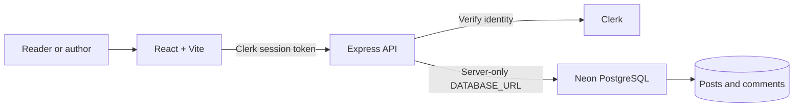

# Blog Platform

BlogVerse is a full-stack publishing app with public reading, member-authored posts, and comments. Clerk owns user identity, the Express API validates session tokens, and Neon stores durable posts and comments. It has no upload workflow, so it does not add object storage.

## Architecture



## Configure

1. Create a Clerk app and choose its sign-in methods.
2. Create a Neon PostgreSQL database.
3. Apply [`server/database/migrations/0001_blog.sql`](server/database/migrations/0001_blog.sql) using Neon SQL Editor or `psql`.
4. Copy `client/.env.example` to `client/.env.local` and configure `VITE_CLERK_PUBLISHABLE_KEY`. Copy `server/.env.example` to `server/.env` and configure `CLERK_SECRET_KEY`, `DATABASE_URL`, and (when cross-origin) `CLIENT_ORIGINS`.
5. Add the client origin to Clerk's allowed origins and the API's `CLIENT_ORIGINS` allowlist when separate.

Keep `CLERK_SECRET_KEY` and `DATABASE_URL` only on the server. Never use a `VITE_` prefix for server secrets. Existing file-backed accounts cannot be safely mapped to Clerk users automatically; old JSON data is not imported.

## Run locally

From the repository root, install root and client dependencies, then run the API and client in separate terminals:

```bash
npm install
npm --prefix server install
npm --prefix client install
npm --prefix server run dev
npm --prefix client run dev
```

The API listens on port `5000`; Vite listens on port `3000` and proxies `/api` to the API.

## Verify

```bash
npm test
npm run build
```

Tests cover verified-owner enforcement and SQL parameterization. Live authentication and Neon persistence require owner-provisioned provider credentials and the applied migration.
