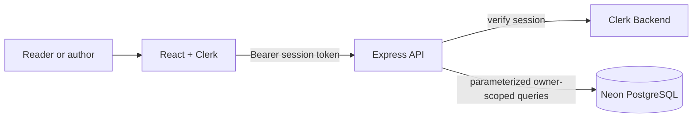

# Blog Platform

BlogVerse is a React/Vite reading and writing app backed by an Express API. Public readers can browse posts and comments; signed-in authors can publish, edit, and delete their own posts and comments.

## Architecture

Clerk is used because the app has user accounts. The API verifies every write session server-side; the publishable key is a browser setting and the secret key stays on the server. Neon stores durable posts and comments. This app has no file-upload flow, so it does not use R2.

## Setup

1. Copy `server/.env.example` to `server/.env`; set `CLERK_SECRET_KEY` and the server-only `DATABASE_URL`.
2. Copy `client/.env.example` to `client/.env`; set `VITE_CLERK_PUBLISHABLE_KEY`.
3. Apply `server/migrations/001_blog.sql` to the Neon database.
4. Install and run the API from `server/` with `npm install` and `npm run dev`.
5. Install and run the client from `client/` with `npm install` and `npm run dev`.

For a cross-origin client, set `CLIENT_ORIGINS` to the exact allowed origins. Same-origin Vercel deployments can leave it empty. Never commit `.env` files or place the Neon connection string or Clerk secret key in `VITE_*` variables.

Run `npm test` from `server/`, `npm run build` from `client/`, and `npm audit` in both packages. Deployment requires the listed Clerk and Neon environment values and the database migration to be applied.

## Project structure

- `client/` — React pages, Clerk sign-in, and public feed
- `server/` — Express API, Clerk token verification, and Neon queries
- `server/migrations/` — versioned PostgreSQL schema
- `api/index.js` — Vercel serverless adapter
