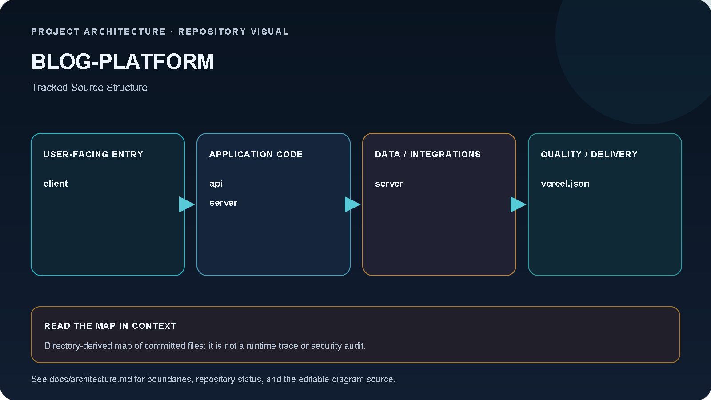

# blog-platform — architecture and repository status

**Repository:** [https://github.com/kalyan870/blog-platform](https://github.com/kalyan870/blog-platform)

**Live link:** https://blog-platform-teal-mu.vercel.app

[Open the editable SVG](images/blog-platform-architecture.svg)

## What this map represents

Source-tree map; it describes tracked paths and does not claim a tested runtime flow.

## Verified repository facts

- Tracked application/package source is present.
- Default branch: `master`.
- Main language reported by GitHub: `JavaScript`.
- Top-level tracked directories: `api`, `client`, `server`.
- GitHub Actions workflow present: `no`.
- Existing build/dependency manifests: `server/package.json`, `client/package.json`, `package.json`.

## Security and data boundaries

This documentation update does not add sign-in, a database, or file storage. Those belong only where the application has a verified account, durable relational-data, or persistent uploaded-file requirement. Review the application code and deployment settings before using private user data; this map is not a security audit.

## Run and test

Use the commands already documented in the [project README](../README.md). No setup or test command is invented here.
